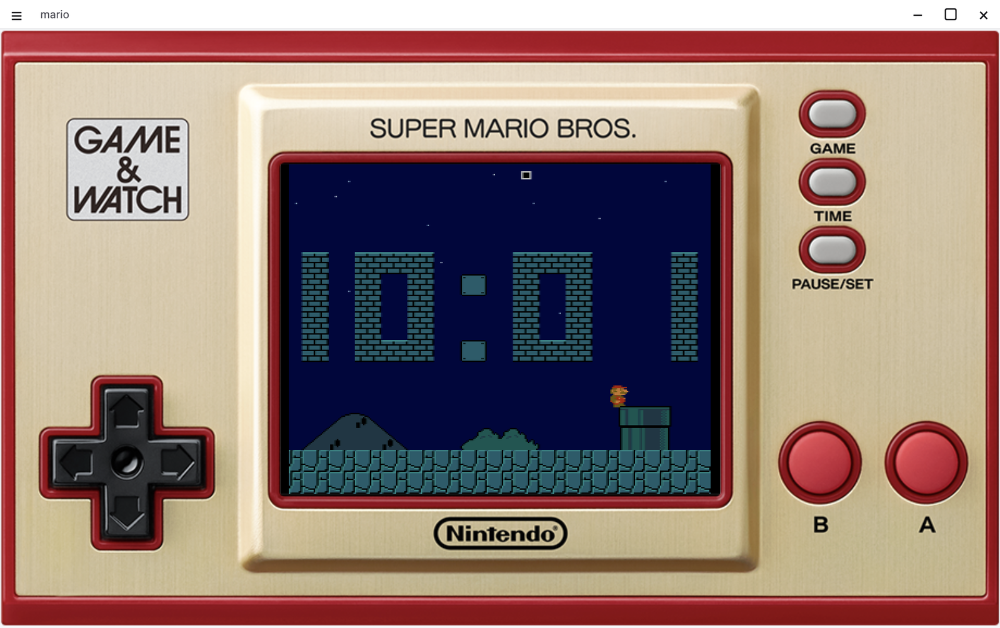
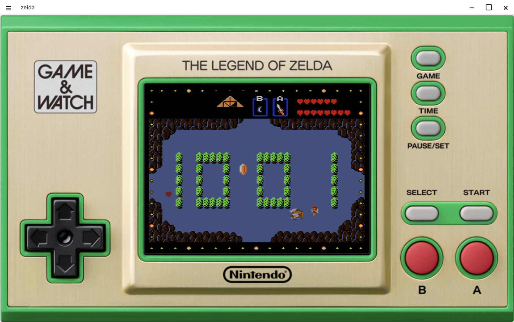
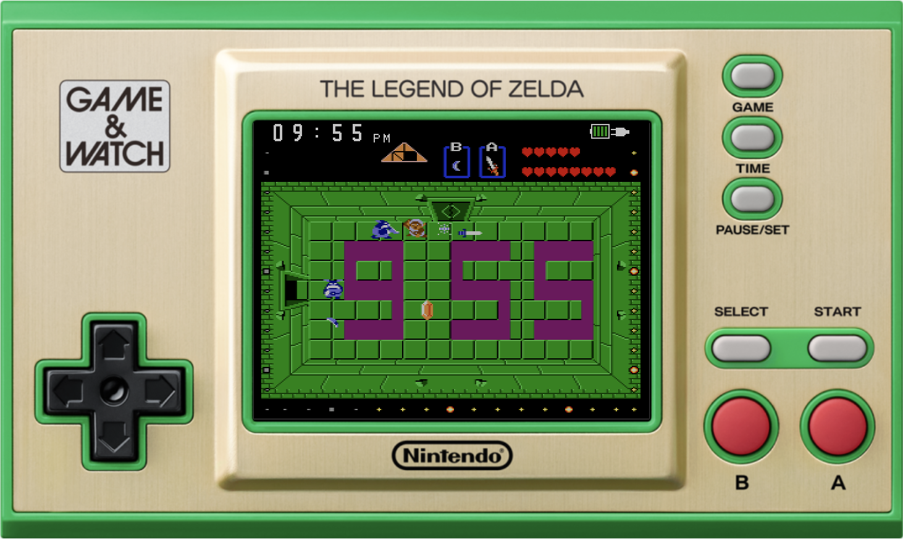
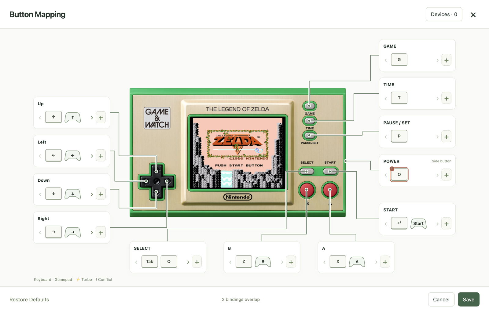

# gnw-emu

**Your Game & Watch, on your desktop.**

Play with the original firmware. Keep its animated clock beside you. Explore Retro-Go.

**English** · [简体中文](README.zh-CN.md)

[Get started](#get-started) · [Dump your firmware](#bring-your-own-firmware) · [User guide](docs/user-guide.md) · [Build from source](docs/development.md)

<table>
  <tr>
    <td width="50%"></td>
    <td width="50%"></td>
  </tr>
  <tr>
    <td align="center"><b>Super Mario Bros.</b></td>
    <td align="center"><b>The Legend of Zelda</b></td>
  </tr>
</table>

## A little handheld, a bigger playground

- **The whole device** — Mario and Zelda firmware, games, clocks and audio, powered by [gwemu](https://github.com/slash-proc/gwemu).
- **A familiar feel** — clickable device frames, crisp pixel scaling, keyboard and gamepad controls, custom bindings and turbo.
- **A clock for your desktop** — a compact, always-on-top window with edge docking and an optional device frame.
- **Room to experiment** — Flash-only and SD Retro-Go, instant save states, and separate working copies of your firmware.

<table>
  <tr>
    <td width="50%"></td>
    <td width="50%"></td>
  </tr>
  <tr>
    <td align="center">Keep the clock. Skip the title bar.</td>
    <td align="center">Make every button yours.</td>
  </tr>
</table>

## Get started

1. **Build the app.** Follow the [macOS / Linux build guide](docs/development.md#macos--linux) or [Windows guide](docs/windows/README.md). There are no published release packages yet; macOS and Windows have been validated, while Linux desktop packaging has not.
2. **Bring your own firmware.** Dump the internal and external flash from your Mario or Zelda Game & Watch using the guides below.
3. **Load and play.** Choose **File → Make ROM…**, select your model and both flash images, then **Save and Load…**. Next time, open the resulting `.gnw.json` with **File → Load ROM…** (`Ctrl/Cmd+O`).

“Make ROM” creates a configuration for existing images. For custom firmware, see [Retro-Go](docs/retrogo.md) and [SD card setup](docs/sdcard.md).

### Bring your own firmware

Firmware and game ROMs are **not included**.

- **[GnWManager: hardware setup](https://github.com/BrianPugh/gnwmanager#compatibility)** — connect a supported debug probe.
- **[GnWManager: unlock and back up your device](https://github.com/BrianPugh/gnwmanager/blob/main/tutorials/unlock.md)** — extract the internal and external flash; includes a video walkthrough.
- **[Game & Watch backup guide](https://github.com/ghidraninja/game-and-watch-backup)** — an alternative dumping workflow.

Use `internal_flash_backup_<model>.bin` and `flash_backup_<model>.bin`, or `bank1.bin` and `ext.bin` from a full dump. Add `bank2.bin` when available. [Image setup details →](docs/user-guide.md#firmware-images)

## Pick up and play

| Action | Default keys |
| --- | --- |
| D-pad · A / B | Arrow keys · `X` / `Z` |
| GAME / TIME / PAUSE / POWER | `G` / `T` / `P` / `O` |
| START / SELECT | `Enter` / `Tab` (also `Q` for SELECT) |
| Save / load instant state | `F5` / `F8` |
| Previous / next state slot | `F6` / `F7` |

**Settings** configures button mappings and hotkeys. **View** switches the device frame, pixel scale and desktop clock mode. **Device** controls battery, USB power and execution.

Instant states support external flash up to 64 MiB, require the same emulator build, and are unavailable with an SD image mounted. [Save state details →](docs/desktop/savestates.md)

## Explore further

[User guide](docs/user-guide.md) · [Retro-Go](docs/retrogo.md) · [SD cards](docs/sdcard.md) · [Build & development](docs/development.md) · [Windows & portable mode](docs/windows/README.md) · [Technical documentation](docs/desktop/README.md)

Built on [gwemu](https://github.com/slash-proc/gwemu), with device management by [gnwmanager](https://github.com/BrianPugh/gnwmanager) and custom firmware from [Retro-Go SD](https://github.com/sylverb/game-and-watch-retro-go-sd). An independent project, unaffiliated with Nintendo.
