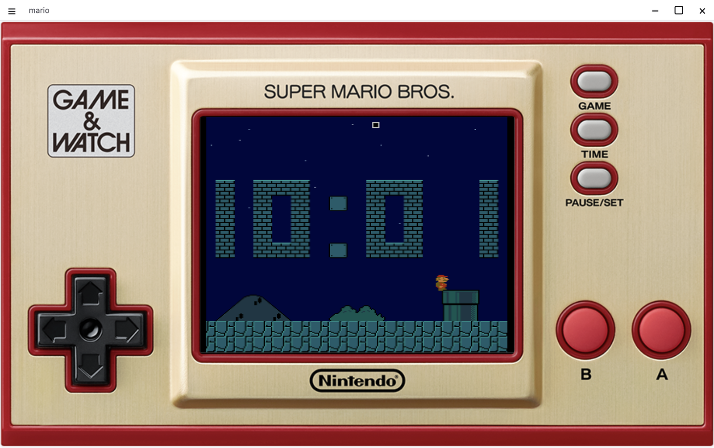
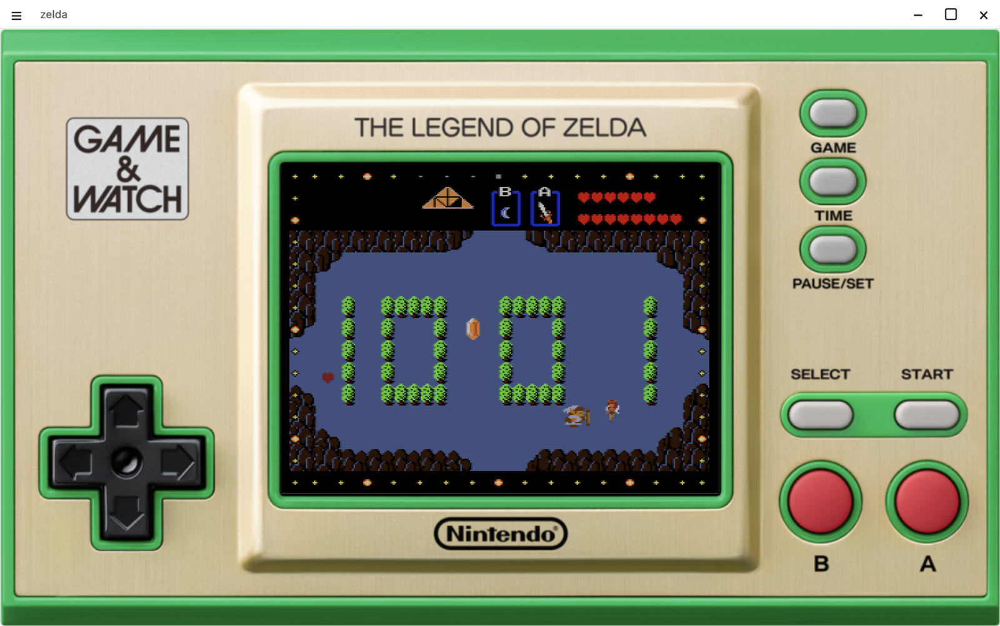
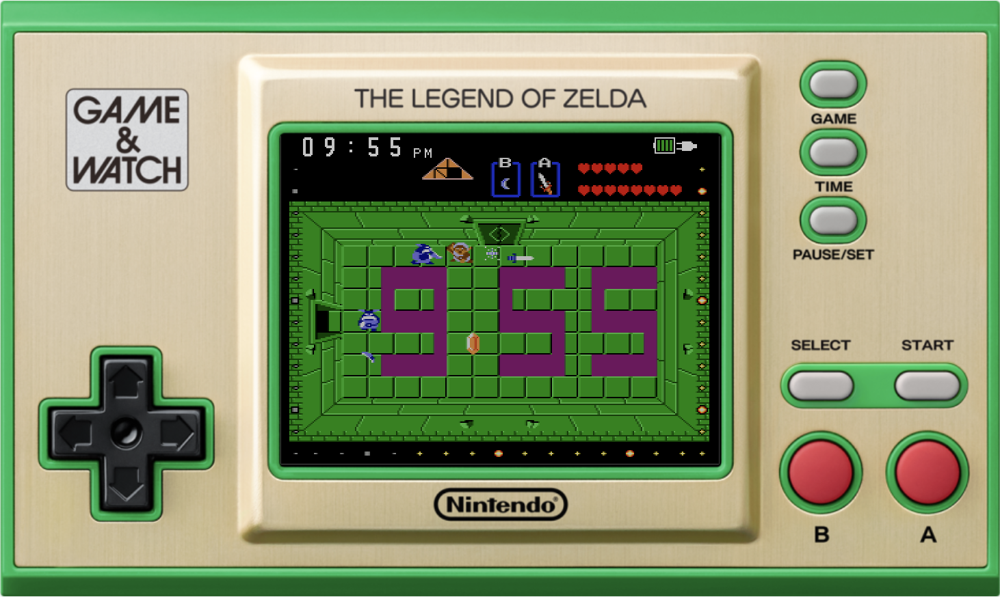
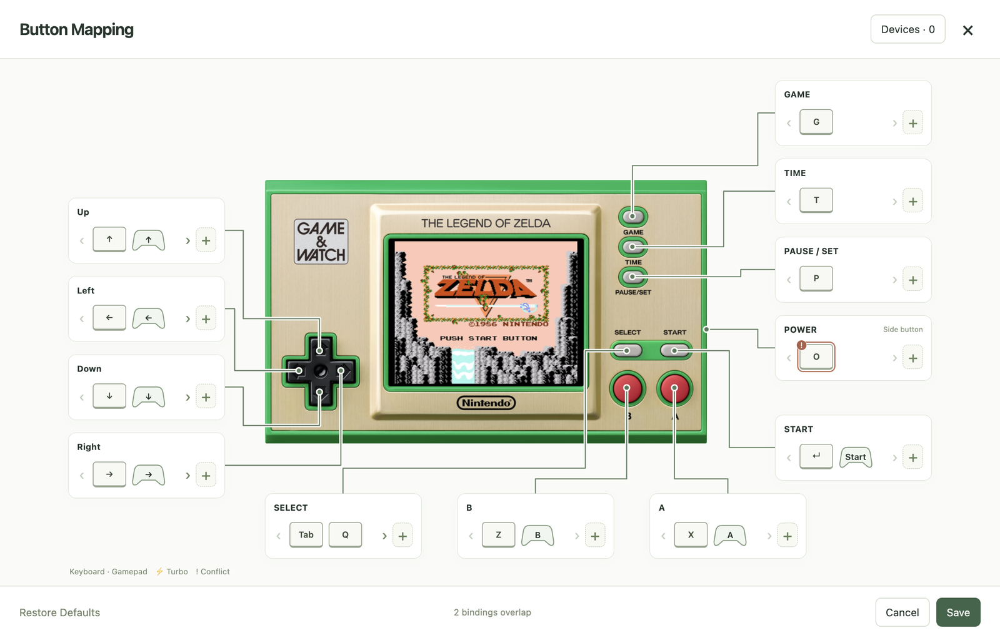

# gnw-emu

**把你的 Game & Watch，搬到桌面上。**

运行原厂固件，让动画时钟陪在桌边，或探索 Retro-Go 的更多玩法。

[English](README.md) · **简体中文**

[快速上手](#快速上手) · [备份实机固件](#准备你自己的固件) · [使用指南（英文）](docs/user-guide.md) · [从源码构建](docs/development.md)

<table>
  <tr>
    <td width="50%"></td>
    <td width="50%"></td>
  </tr>
  <tr>
    <td align="center"><b>Super Mario Bros.</b></td>
    <td align="center"><b>The Legend of Zelda</b></td>
  </tr>
</table>

## 小掌机，更多玩法

- **整台设备的体验** — 基于 [gwemu](https://github.com/slash-proc/gwemu)，运行 Mario 和 Zelda 固件，保留游戏、时钟与声音。
- **熟悉的手感** — 可点击的机身按键、清晰的像素缩放、键盘与手柄、自定义映射及连发。
- **桌边的动画时钟** — 小巧的置顶窗口，支持贴边停靠和机身边框开关。
- **自由尝试** — 支持 Flash-only 与 SD Retro-Go、即时存档；固件在独立副本中运行。

<table>
  <tr>
    <td width="50%"></td>
    <td width="50%"></td>
  </tr>
  <tr>
    <td align="center">留下时钟，收起标题栏。</td>
    <td align="center">每个按键，都按你的习惯。</td>
  </tr>
</table>

## 快速上手

1. **构建应用。** 按照 [macOS / Linux 构建指南](docs/development.md#macos--linux)或 [Windows 指南](docs/windows/README.md)操作。目前尚无已发布的安装包；macOS 和 Windows 已验证，Linux 桌面打包尚未验证。
2. **准备自己的固件。** 参考下方教程，从 Mario 或 Zelda 实机导出内部与外部 Flash。
3. **加载并开始。** 打开 **文件 → 制作 ROM…**，选择机型和两份 Flash 镜像，点击 **保存并加载…**。以后通过 **文件 → 加载 ROM…**（`Ctrl/Cmd+O`）打开生成的 `.gnw.json` 即可。

“制作 ROM”为已有镜像创建配置。自定义固件请参考 [Retro-Go](docs/retrogo.md) 和 [SD 卡配置](docs/sdcard.md)。

### 准备你自己的固件

项目**不附带固件或游戏 ROM**。

- **[GnWManager：硬件连接](https://github.com/BrianPugh/gnwmanager#compatibility)** — 连接支持的调试器。
- **[GnWManager：解锁并备份实机](https://github.com/BrianPugh/gnwmanager/blob/main/tutorials/unlock.md)** — 导出内部与外部 Flash，内含视频教程。
- **[Game & Watch 备份指南](https://github.com/ghidraninja/game-and-watch-backup)** — 另一种固件导出流程。

选择 `internal_flash_backup_<model>.bin` 和 `flash_backup_<model>.bin`，或完整 dump 中的 `bank1.bin` 与 `ext.bin`；如有 `bank2.bin`，一并添加。[镜像配置详解（英文）→](docs/user-guide.md#firmware-images)

## 常用操作

| 操作 | 默认按键 |
| --- | --- |
| 十字键 · A / B | 方向键 · `X` / `Z` |
| GAME / TIME / PAUSE / POWER | `G` / `T` / `P` / `O` |
| START / SELECT | `Enter` / `Tab`（SELECT 也支持 `Q`） |
| 保存 / 读取即时存档 | `F5` / `F8` |
| 上一个 / 下一个存档槽 | `F6` / `F7` |

**设置**菜单调整按键映射与热键；**视图**切换机身边框、像素倍率和桌面时钟；**设备**控制电池、USB 供电与运行状态。

即时存档支持最大 64 MiB 外部 Flash，需要使用相同的模拟器构建；挂载 SD 镜像时不可用。[存档说明 →](docs/desktop/savestates.md)

## 继续探索

[使用指南（英文）](docs/user-guide.md) · [Retro-Go](docs/retrogo.md) · [SD 卡](docs/sdcard.md) · [构建与开发（英文）](docs/development.md) · [Windows 与绿色版](docs/windows/README.md) · [详细文档](docs/desktop/README.md)

基于 [gwemu](https://github.com/slash-proc/gwemu)，使用 [gnwmanager](https://github.com/BrianPugh/gnwmanager) 管理设备，自定义固件来自 [Retro-Go SD](https://github.com/sylverb/game-and-watch-retro-go-sd)。本项目独立开发，与任天堂无关联。
